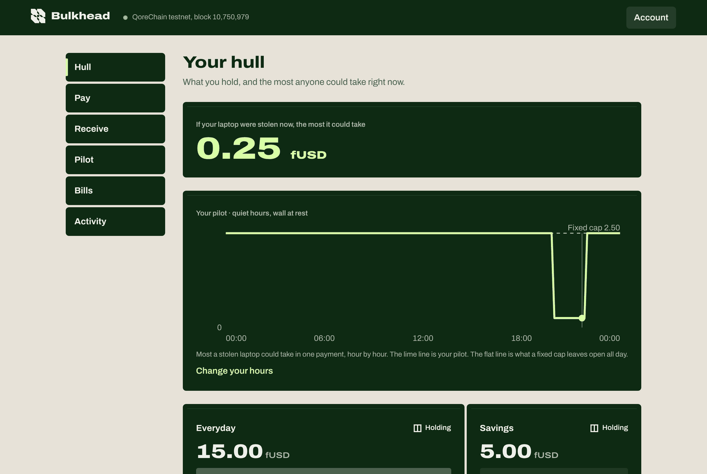
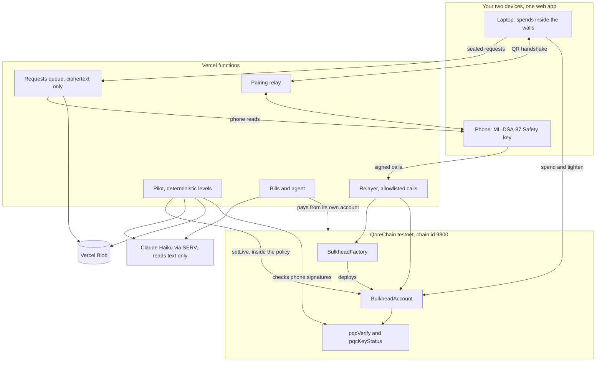
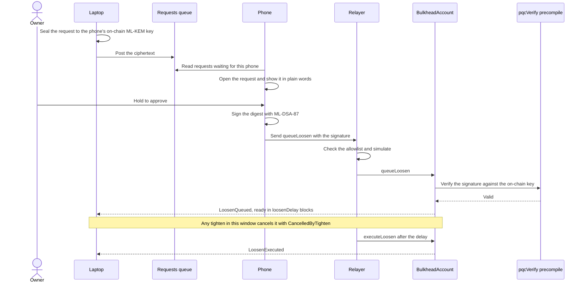
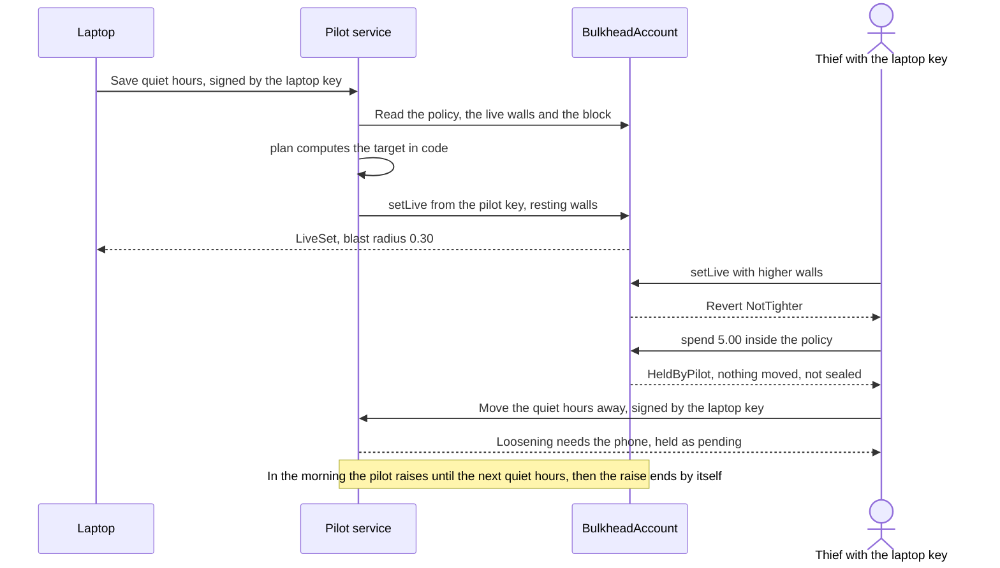
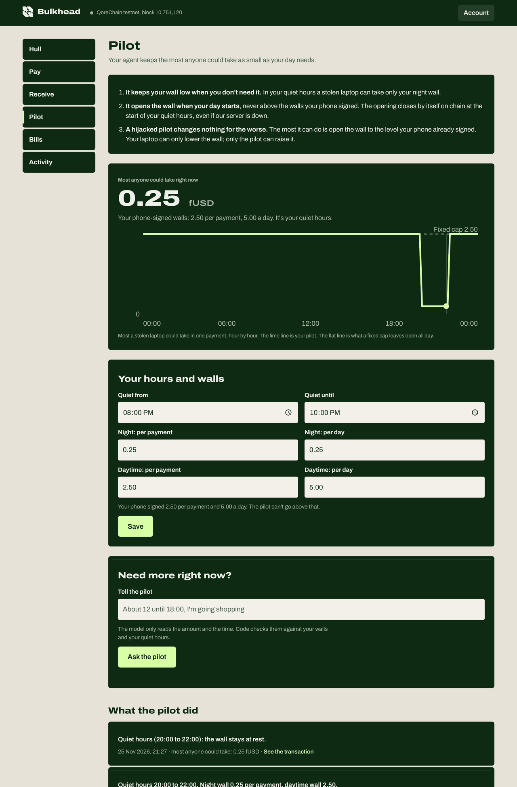
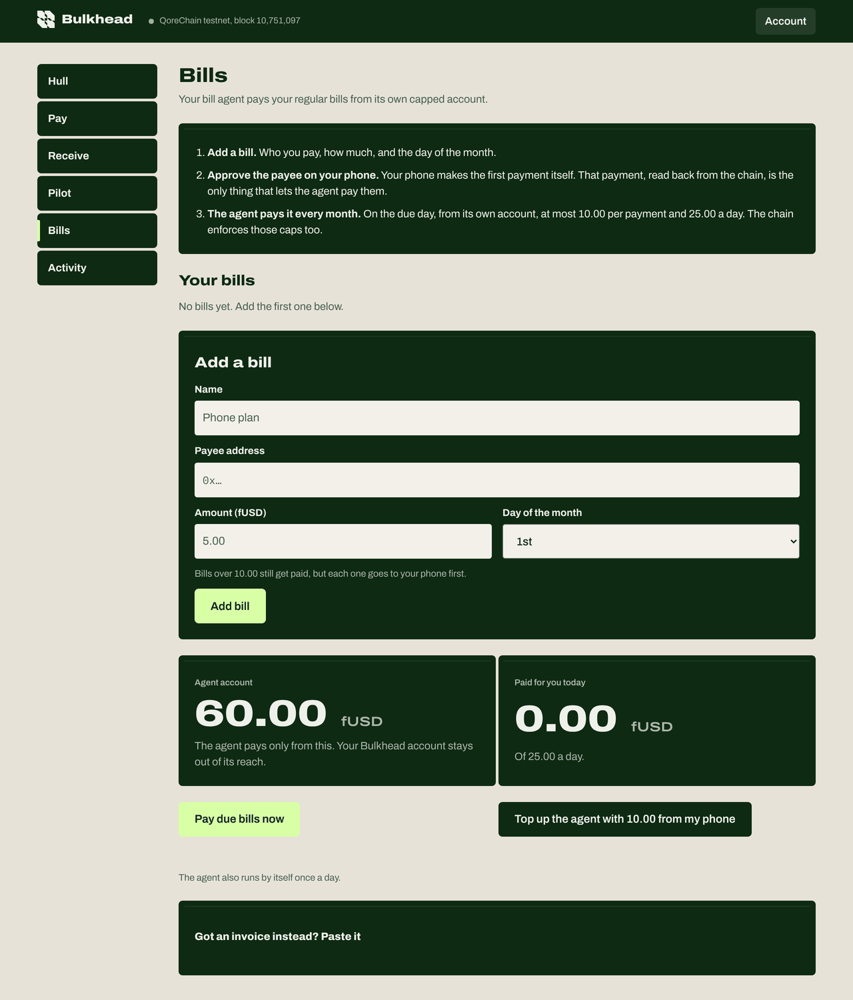
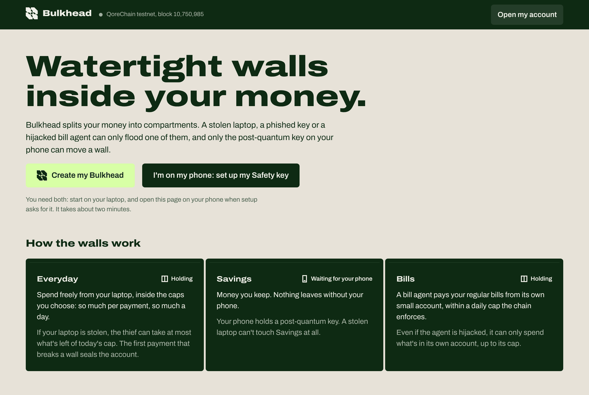
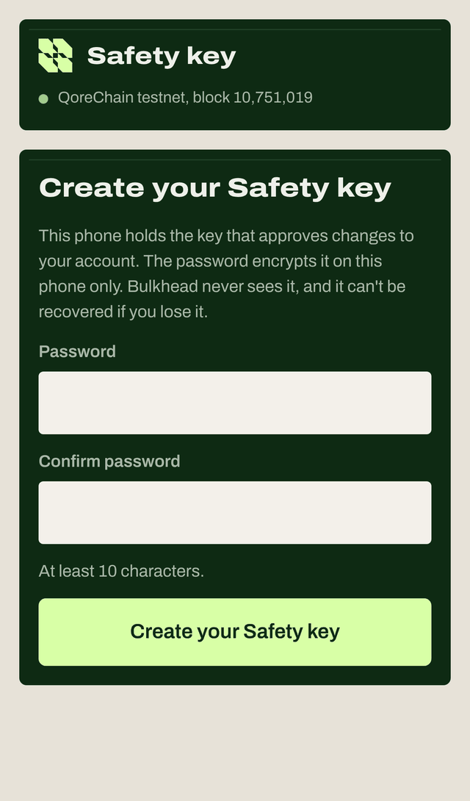
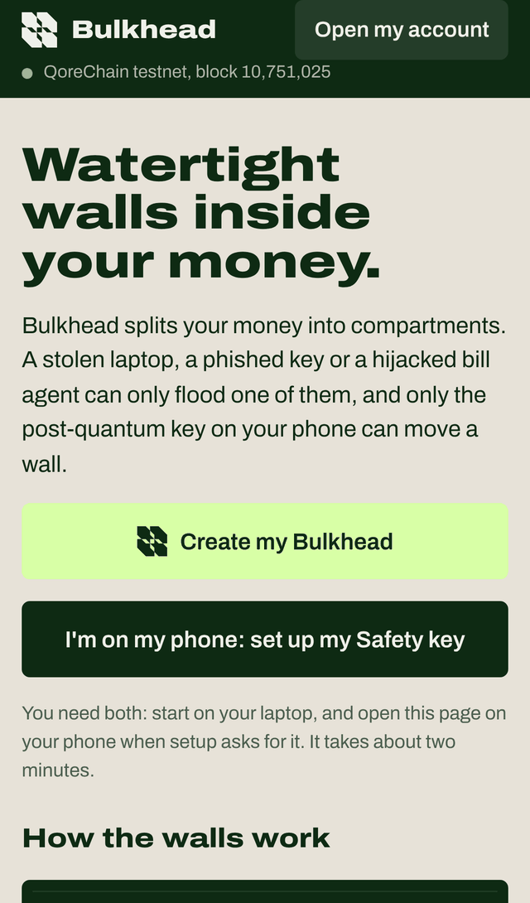

# Bulkhead

**Damage-bounded money whose blast radius breathes: the most a stolen laptop can take follows your day, and only the post-quantum key on your phone can widen a wall.**

[Open the app](https://bulkhead-blush.vercel.app) · [Phone view](https://bulkhead-blush.vercel.app/#/phone) · [Demo video](VIDEO_LINK_TODO) · [Contracts on testnet](#deployments)



## The problem

- A stolen or phished key drains a whole wallet in one go. Nothing on chain says how much one key may take.
- A fixed cap leaves the same exposure all day and all night. You pay for a 3 a.m. thief with the limit you need at lunchtime.
- AI agents get standing spending power. A hijacked agent holds it until someone notices.
- Quantum computers will break the ECDSA keys most accounts use. A key that can widen its own limits is the first thing a quantum attacker wants.

Bulkhead answers with walls the chain enforces, and a second key, post-quantum and on a second device, that is the only thing able to move them.

## What Bulkhead does

Bulkhead is damage-bounded money on QoreChain. Funds sit in compartments. Each one has its own blast radius, the most anyone could take right now, and the chain enforces it.

- **Everyday.** The laptop key spends freely inside a per-payment cap, a refilling period cap and an optional payee list. That is its whole blast radius.
- **Savings.** A floor per asset. Everyday spends can never take the balance below it. Only the phone moves money below the floor.
- **Bills and agent.** A bill agent has its own chain account with its own rule. The Bulkhead account tops it up, and only with the phone's approval.
- **The two-device split.** The laptop spends inside the walls. The phone's ML-DSA-87 key widens them. The laptop can tighten at once but can never widen.
- **Tripwires.** A spend that breaks a wall does not revert. The account seals inside that same transaction, so the seal survives the attacker's own call. Sentinels can pause spending for at most half a period, once per period.
- **Break-glass.** The laptop or the phone can send everything to a recovery account. The destination is pinned by a phone-signed widening, and it must be another Bulkhead account, so a thief can only send funds to safety.
- **The pilot.** A key that moves the live walls inside the phone-signed policy. It is how the blast radius follows your day. See the next section.

## The pilot: a blast radius that breathes

A fixed cap has one height. The pilot lets the wall sit low while you are asleep and rise while you are working, and it can never go above what your phone signed.

1. The phone signs the pilot key into the account. On v4 it is part of the phone-signed `Init` at creation, and later the phone can replace it with `setPilotWithApproval`, effective at once. The pilot can never be the laptop key or the phone key.
2. On the laptop you save quiet hours, a night wall and a daytime wall. A stricter schedule (quiet hours that cover the old ones, walls no higher) takes effect on the laptop's signature. A looser one goes to your phone: the phone signs that exact schedule with ML-DSA-87, and the server checks the signature against your on-chain Safety key with the `pqcKeyStatus` and `pqcVerify` precompiles before the pilot follows it. The daytime wall can never be above the phone-signed ceiling.
3. The pilot service computes the target from the clock and the chain and, if the chain differs, sends `setLive` from the pilot key. In quiet hours the wall drops to its resting level. In the day it rises, with an end block set to the start of the next quiet hours.
4. A raise closes itself. `effectiveCaps` returns the resting values once `until` has passed, even if the pilot is gone. A raise can last one period at most, or `setLive` reverts with `TooFarAhead`.
5. If you need more, you type something like "about 12 until 18:00". The model reads two fields, the amount and the time. `planRequest` in `app/server/pilot.ts` decides. It clamps to the ceiling and ends the raise at the earlier of your time and the start of quiet hours.
6. Inside quiet hours the pilot refuses to raise at all. A thief with your laptop could be the one asking, so the request goes to your phone.

Why this is safe to hand to an agent:

- A hijacked pilot is no worse than a fixed cap. It can move the live walls anywhere from zero to the phone-signed policy, and no higher (`AbovePolicy`). Its worst case is the policy itself.
- The laptop can only lower the live walls. If it tries to raise one, `setLive` reverts with `NotTighter`. A stolen laptop key alone cannot reopen a wall the pilot closed.
- The pilot does not bump the epoch, so it cannot cancel the phone's queued widenings.
- A spend that fits the policy but not the live walls is refused with a `HeldByPilot` event. It does not seal the account.

It is live and proven. On v3, the night wall closed to 0.40 and a stolen laptop's 5.00 was held (transactions are linked in [Proof on testnet](#proof-on-testnet)). On v4 the pilot is set from block one, and the live site closes the wall to 0.30 the moment quiet hours are saved.

## What a stolen key can take

| Attack | What the chain lets it take | Why |
| :--- | :--- | :--- |
| Stolen laptop, by day | At most the blast radius: the smaller of the per-payment cap, the period allowance left and the balance above the floor. Anything over a wall takes nothing and seals the account | `spend` checks `perTxCap`, `periodCap`, the floor and the payee list. A breach trips and seals, and moves nothing |
| Stolen laptop, in quiet hours | At most the resting wall, 0.30 to 0.40 in the live runs. A bigger spend that still fits the policy is held, nothing moves, the account is not sealed | `effectiveCaps` returns the pilot's resting values. `HeldByPilot` is emitted. The pilot also refuses to raise in quiet hours |
| Stolen laptop tries to reopen the wall | Nothing | `setLive` and `tightenPolicy` from the laptop revert with `NotTighter`. It also cannot widen anything else |
| Hijacked pilot | The policy the phone signed, the same as a fixed cap. Never more | `AbovePolicy`, `TooFarAhead`. The pilot cannot move funds, cannot cancel widenings and cannot be the laptop or phone key |
| Hijacked bill agent | Its own account balance, in fUSD only, 10 per payment, 25 per day, only `fUSD.transfer`. The Bulkhead account is out of its reach | The chain's spending rule on the agent account. A hijacked key calling `spend` on the Bulkhead account hits `NotEveryday` |
| Server or relayer compromised | Nothing it can spend. It can refuse to relay | The queue holds only QoreSeal ciphertext. The relayer only sends an allowlist of phone-signed calls and `deploy`, simulates first, and the account checks the ML-DSA-87 signature on chain. It cannot send `spend`, `seal` or `tightenPolicy` |
| Phished widening | Nothing yet. It waits `loosenDelay`, about an hour in the app, and the owner sees it queued | Any tighten bumps the epoch and `executeLoosen` then reverts with `CancelledByTighten`. Early runs revert with `TooEarly` |
| Lost phone | Nothing while the wait runs | `proposeSafety` seals the account at once. The change waits `safetyDelay`, about three days in the app. The old phone can veto it, and `confirmSafety` reverts with `TooEarly` before the end. The factory forces `safetyDelay` to be at least `loosenDelay` |
| Quantum attacker | A classical laptop key at most, which is the stolen laptop rows above. It cannot widen a wall | Every widening, phone-approved spend, seal-by-phone and pilot change needs an ML-DSA-87 signature, checked through the `pqcVerify` precompile |

One more case. A thief with the laptop key can't move your quiet hours either. A schedule change that loosens anything (shorter quiet hours, higher walls, a new time zone) waits for your phone's post-quantum signature, checked on chain. In daytime, the laptop can still ask the pilot for more room, but never above the phone-signed ceiling, so a stolen laptop by day is no worse off than a fixed cap.

## What users control

- The laptop can't spend over the per-payment cap, the period cap or the floor. A breach trips a tripwire and seals the account, and `spend` returns `false` without moving anything.
- The laptop can't loosen a wall. `tightenPolicy` and `setLive` revert with `NotTighter` if any field is looser.
- The pilot can't go above the policy. `setLive` reverts with `AbovePolicy`, and a raise can't last more than a period (`TooFarAhead`). Only the pilot or the laptop can call it, otherwise `NotPilot`.
- A pilot can't be the laptop key. `setPilotWithApproval` and `executeLoosen` revert with `BadPilot`, and `deploy` reverts with `BadInit`.
- Only a valid ML-DSA-87 signature from the phone widens anything. A forged one reverts with `BadSafetySignature`. A reused one reverts with `NonceReused`, a late one with `Expired`.
- A widening waits `loosenDelay` blocks. `executeLoosen` reverts with `TooEarly` before that, and `CancelledByTighten` if you tightened anything in between.
- Break-glass goes only to the pinned recovery account. Without one, `NoRecovery`. A recovery that isn't a Bulkhead account is `RecoveryNotAccount`.
- A new phone can't take over quickly. The wait is `safetyDelay`, the old phone can veto it, and the account is sealed throughout. The new key must be registered and proven on chain (`NoSafetyKey`, `SafetyKeyNotProven`).
- A sentinel can pause spending for at most half a period (`ThrottleTooLong`), once per period (`ThrottleBudgetUsed`). It can't seal, move funds or widen.
- There is no admin, no proxy and no `ecrecover` in the contracts. Nobody, including us, can change a deployed account's rules except through the paths above.

## Post-quantum, end to end

- **The phone key is ML-DSA-87.** The account reads the phone's key from chain state on every call with the `pqcKeyStatus` precompile, and checks signatures with `pqcVerify`. An inactive precompile reverts, so it fails closed. A key that isn't registered and proven authorises nothing.
- **The Bulkhead Handshake pairs the phone without typing an address.** The laptop makes a throwaway ML-KEM-1024 key and an X25519 key and shows a QR that commits to them. The phone checks the keys against the QR, signs a QoreSeal recipient card with its keys, and seals it to the laptop. The laptop opens the reply and checks the card against the keys the chain holds for that phone. Both screens show four words from the whole exchange, and you confirm they match. That catches anyone who swapped the reply in between, our own server included.
- **Phone requests are sealed.** The laptop and the bill agent seal each request with QoreSeal ML-KEM to the phone's on-chain key. The server queue holds ciphertext and refuses anything that isn't a QoreSeal envelope. It can't read a request or forge one.
- **EVM windows are scoped to the account.** Relayed calls run in a short, small window that lists only the target account and never a token. In the round 16 red-team spike, a window that listed a permit-capable token left the whole balance drainable, so Bulkhead never lists one.
- **Unified accounts use `eth_secp256k1`.** A refused authenticator execution still returns tx code 0, so the app reads balances and events, not the tx code.

## AI agents, and what they can't decide

Two agents run inside the walls.

- **The pilot** reads "about 12 until 18:00" into an amount and a time. It never picks a number.
- **The bill agent** reads invoices into a payee, an amount and a token.

In both, the model (Claude Haiku through SERV) only extracts fields. Deterministic code decides:

- `app/server/policy.ts` decides every bill. It pays only an approved payee, in the allowed token, within the per-payment and daily rule. Anything else is `ask-phone` or `reject`. An unknown payee or an amount over the rule is sealed to the phone, and a mangled address is rejected.
- `app/server/pilot.ts` computes every wall level and every end time.

The chain caps both again. The bill agent's account allows fUSD only, 10 per payment and 25 per day, and the pilot can't pass the phone-signed policy. In the live runs a poisoned "pay 5000 to an unknown address" invoice paid nothing and went to the phone as a sealed request, and an invoice with an address the model had mangled was rejected.

## Architecture

The laptop app and the phone view run in the browser. A set of Vercel functions carries ciphertext and signed calls, and holds the keys for the pilot, the relayer and the bill agent. The chain holds the rules.



A widening needs the phone and a wait. The phone signs, and the relayer pays the gas.



The pilot closes the wall at night, and a stolen laptop can't reopen it.



## Screenshots

Captured from the live app on QoreChain testnet, with real data from a demo account.

<table>
<tr>
<td align="center"><br><sub>Hull: the most anyone could take right now (0.25 fUSD), the pilot's blast radius through the day, and the compartments.</sub></td>
<td align="center"><br><sub>Pilot: quiet hours and walls, capped by what the phone signed, with a log of what the pilot did.</sub></td>
</tr>
<tr>
<td align="center"><br><sub>Bills: the bill agent pays from its own capped account (60.00 fUSD, 25.00 a day).</sub></td>
<td align="center"><br><sub>Landing: compartments and walls, and the two-device split.</sub></td>
</tr>
</table>

<table>
<tr>
<td align="center"><br><sub>Phone: create the Safety key.</sub></td>
<td align="center"><br><sub>Phone: landing page.</sub></td>
</tr>
</table>

## Try it

You need a laptop browser, a phone browser and a little QOR. The live app runs on QoreChain testnet `qorechain-diana`. Nothing here is real money.

1. On the laptop, open [bulkhead-blush.vercel.app](https://bulkhead-blush.vercel.app) and press **Create my Bulkhead**.
2. Choose a password of at least 10 characters. It encrypts your laptop key in the browser. Bulkhead never stores it.
3. Send a little QOR to the laptop address that setup shows. The laptop key pays its own fees. QoreX works, and so does any wallet that can send QOR on the testnet.
4. On the phone, open [`/#/phone`](https://bulkhead-blush.vercel.app/#/phone) and create your Safety key. This is an ML-DSA-87 key that lives on the phone. Register it when the page asks. It needs a little QOR for gas.
5. Pair the two with the Bulkhead Handshake. Scan the QR on the laptop with the phone. Both screens then show four words. Confirm they match.
6. Set your walls: how much you spend in a day, and how much you keep. Bulkhead turns that into caps.
7. Approve the account on the phone. The live relayer deploys it. Nothing moves yet.
8. Fund the account with fUSD from QoreX.
9. Open **Pilot** on the laptop, set your quiet hours and watch the wall close. Try **Pay** with an amount over your cap and see what the chain does.

A live demo account to inspect: [`0xB5a69255…0Df6`](https://explore.qore.network/address/0xB5a69255fE41c9ab4D9A52478A22966E3ddE0Df6). It is a v4 account, made with a real phone on 25 November.

## Proof on testnet

Everything below ran on `qorechain-diana`. Full results, including every refusal, are in [`docs/DEPLOYMENTS.md`](docs/DEPLOYMENTS.md). The transactions are on the [QoreChain explorer](https://explore.qore.network).

| Run | Result | Transaction |
| :--- | :--- | :--- |
| v3 night wall (21 Nov, round 25) | Pilot lowers the wall for the night, blast radius 0.40 | [`0x2fbbdad9…8483`](https://explore.qore.network/tx/0x2fbbdad9becb756118dfc7434da9f87deb07e94c26de91241201e5aba5458483) |
| v3 night wall | Stolen laptop tries 5.00 at night: `HeldByPilot`, nothing moved, not sealed | [`0x9feb3542…6771`](https://explore.qore.network/tx/0x9feb3542945699996bd3c4aae0b8ca84dee86c7a4edfb5d12b481c971cc26771) |
| v3 night wall | Stolen laptop tries to reopen the wall: refused, `NotTighter` | no tx, refused in simulation |
| v3 night wall | Pilot raises to the ceiling for 40 blocks, blast radius 5.00 | [`0xfcb0c383…281b`](https://explore.qore.network/tx/0xfcb0c383a499067119fbce26031d92f4b640c28da3ec59e26a9205fc46c8281b) |
| v3 night wall | Pilot tries to go above the ceiling: refused, `AbovePolicy` | no tx, refused in simulation |
| v4 instant pilot (25 Nov, round 27) | Account created with the pilot in the phone-signed `Init`, pilot set from block one | [`0xca1c60fe…025d`](https://explore.qore.network/tx/0xca1c60fe0f73f450c04a53fabf254640fb790f0edc097a10a61f140f9bc6025d) |
| v4 instant pilot | Pilot lowers the wall right after creation, caps 0.40 / 0.40 | [`0x5053704c…233a`](https://explore.qore.network/tx/0x5053704c3b8ed01dcbc04a1e4d2c918f84ebca0fba9f7394a41cc5686579233a) |
| v4 instant pilot | Phone replaces the pilot with a real ML-DSA-87 signature, effective at once | [`0xf9ae8c9d…4b11`](https://explore.qore.network/tx/0xf9ae8c9dbaf8bbf6b3c716824bc980d00202a6d351b787acd44dbd9320894b11) |
| v4 instant pilot | Forged phone signature to change the pilot: refused, `BadSafetySignature` | no tx |
| Live site, round 26 (21 Nov) | Phone authorises a v3 account, the live relayer deploys it | [`0xba5720b6…41d6`](https://explore.qore.network/tx/0xba5720b66bd79ceadbb105dba3bf77dca1c9551f9c287e9602eceb46337641d6) |
| Live site, round 26 | Laptop saves quiet hours, the live pilot closes the wall to 0.30 | [`0x500f34a2…0f8a`](https://explore.qore.network/tx/0x500f34a27153fb88a5e77cae4040c98a7bfab17828789801d919cb7406d90f8a) |
| Live site, round 26 | Stolen laptop tries 5.00, held, 10.00 fUSD left, not sealed | [`0xbe76fc8c…b65a`](https://explore.qore.network/tx/0xbe76fc8c5abb970e97993a7327d821dc97808c3b042ab410e98989a8e7c4b65a) |
| Live site, round 26b | Daytime hours saved, the wall opens, 0.30 to 2.00 | [`0x5e45a990…b9bf`](https://explore.qore.network/tx/0x5e45a9908dae5591e104680eb21fba20109219ecd5a24835eff5c1dd5fa5b9bf) |
| Live site, round 26b | "about 4 until 14:00, shopping": the model read 4 and 14:00, code opened within the ceiling, blast radius 4.00 | [`0x72cf2e47…04d2`](https://explore.qore.network/tx/0x72cf2e470b258733f133812fd60fadb1163fb816014e6fa80decad2e5ad404d2) |
| Live site, round 26b | Back to quiet hours, blast radius 0.30 | [`0x9a7a337c…96f8`](https://explore.qore.network/tx/0x9a7a337c8e6de514f66eb5ed7161fb35f8bb1a190338e2125f675d50a65896f8) |
| Live site on v4, round 28 (25 Nov) | The phone authorised a v4 account with the live pilot in its `Init`. Quiet hours saved, the wall closed to 0.30 / 0.30 at once, no widening delay. Hashes `0xc6eb942e…a373` and `0x188f9842…a578` | account `0xE44f9475…53C2`, not linked |
| Stolen-key seal (21 Nov, round 22) | Stolen key spends 6.00 over the 5.00 cap: tx success, sealed, nothing moved | [`0x687fb72d…878b`](https://explore.qore.network/tx/0x687fb72d3e47b14a2f105d5aabdff640f2486508f7fd1fcb8ac4c1f51bb6878b) |
| Forged signatures | Factory deploy, phone seal, `spendWithApproval`, a pilot change and the relayer all refused forged ML-DSA-87 signatures. The relayer answered 422 in simulation and spent no gas | refusals have no transaction |

Round 28 is recorded in the spike log with shortened hashes only, so those two are not linked here. The v3 night wall numbers come from the rerun on factory v3 `0xcec5ef27…9db6` after the laptop-can-only-lower fix.

## Deployments

QoreChain testnet `qorechain-diana`, EVM chain id 9800. Blocks take about 1.42 seconds.

| Contract | Address | Notes |
| :--- | :--- | :--- |
| `BulkheadFactory` v4 | [`0xdd2e1ed55393db01086c5a4d829f4558094870cb`](https://explore.qore.network/address/0xdd2e1ed55393db01086c5a4d829f4558094870cb) | Current. The pilot is signed in at creation and set later with `setPilotWithApproval`, no wait. Deployed 25 November |
| `BulkheadFactory` v3 | [`0xcec5ef27b5ce235c2c13ef8f1549abb986099db6`](https://explore.qore.network/address/0xcec5ef27b5ce235c2c13ef8f1549abb986099db6) | Legacy, still served by the relayer. Accounts keep the delayed pilot path. The laptop can only lower the live walls |
| `BulkheadFactory` v2 | [`0xe723f38ffb199548f96da2b6cc677cbb2740372f`](https://explore.qore.network/address/0xe723f38ffb199548f96da2b6cc677cbb2740372f) | Legacy, still served by the relayer. Phone-only seal and lost-phone replacement |
| `BulkheadFactory` v3, first deploy | [`0x6b1f671a674ebe6d0bcfba235e9f4874e431626b`](https://explore.qore.network/address/0x6b1f671a674ebe6d0bcfba235e9f4874e431626b) | Superseded the same day. The laptop could raise the live walls. Do not use |
| `BulkheadFactory` round 20 | [`0x3df113cf4a7ddb5d22eed33f8de430d531026355`](https://explore.qore.network/address/0x3df113cf4a7ddb5d22eed33f8de430d531026355) | Superseded by v2. Live parity run, commit `6c7778a` |
| `BulkheadFactory` round 20, first | [`0x72d28d81edbd8109689620fc73a843d41990b843`](https://explore.qore.network/address/0x72d28d81edbd8109689620fc73a843d41990b843) | Superseded, before the refilling allowance and sentinel fixes |
| Live demo account, v4 | [`0xB5a69255fE41c9ab4D9A52478A22966E3ddE0Df6`](https://explore.qore.network/address/0xB5a69255fE41c9ab4D9A52478A22966E3ddE0Df6) | Made with the owner's phone on 25 November. The account the live app shows |
| Test account, v4 | [`0x8F8831056835ff1b88f3C46350eBFe8BC90c5bc4`](https://explore.qore.network/address/0x8F8831056835ff1b88f3C46350eBFe8BC90c5bc4) | Round 27, `loosenDelay` 2,500 |
| Round 26 account, v3 | [`0x6759AD2986A2CFABBC1be669c7eaad7c8d7382df`](https://explore.qore.network/address/0x6759AD2986A2CFABBC1be669c7eaad7c8d7382df) | Deployed through the live relayer from the phone |
| Pilot test account, v3 | [`0xeCF93Fe3c4565e4cF7a809Deb35482BFcbDDC7Ad`](https://explore.qore.network/address/0xeCF93Fe3c4565e4cF7a809Deb35482BFcbDDC7Ad) | Round 25 night wall run |
| Demo account, v2 | [`0x3d68f146EaEbFBCB1C0f64eFC07DbD687fc76959`](https://explore.qore.network/address/0x3d68f146EaEbFBCB1C0f64eFC07DbD687fc76959) | Round 23 |
| Test account, v2 | [`0x5412c0F2267872aFc7E53312d6A25a778619d0Ca`](https://explore.qore.network/address/0x5412c0F2267872aFc7E53312d6A25a778619d0Ca) | Phone replaced, sealed |
| Agent compartment demo | [`0x1c548456DE8683d816409eceBd19D3C4BAD75a5E`](https://explore.qore.network/address/0x1c548456DE8683d816409eceBd19D3C4BAD75a5E) | fUSD policy, round 21 and the stolen-key seal in round 22 |
| Live parity account | [`0x7C66b7D53EB9F4692000d3578eAd5a1385e359Be`](https://explore.qore.network/address/0x7C66b7D53EB9F4692000d3578eAd5a1385e359Be) | Deployed by the factory with a real ML-DSA-87 signature |
| Pilot key, live | [`0x4e21ed6743B7e8D169f6C09f5045D016B53f3888`](https://explore.qore.network/address/0x4e21ed6743B7e8D169f6C09f5045D016B53f3888) | Held only on Vercel. The production pilot |
| Pilot key, v3 test | [`0x617DE59bcA65Ce7208dB8c77ebCF7382833aE159`](https://explore.qore.network/address/0x617DE59bcA65Ce7208dB8c77ebCF7382833aE159) | Round 25 test only |
| Bill agent account | [`0xbAB12dbb1de5FB86D1CA2C8B9cd0c73985A8D4A8`](https://explore.qore.network/address/0xbAB12dbb1de5FB86D1CA2C8B9cd0c73985A8D4A8) | Own chain account, `qor1h2cjmwcauhacd5w29j9ee5x88xz6349g7u0209`. fUSD only, 10 per payment, 25 per day |
| fUSD test token | [`0x97143B771D34ddb9130b807b135Ae675A5a963CA`](https://explore.qore.network/address/0x97143B771D34ddb9130b807b135Ae675A5a963CA) | 6 decimals. Funded into accounts with `MsgConvertCoin` |

The relayer's own account is `qor1jucepu367uyf74dtrpqnxyawktagxaqslp6ffv`. It pays gas for phone-signed calls and holds no user funds.

The relayer is set to serve v4, v3 and v2 (`FACTORY_ADDRESS`, newest first). Endpoints: EVM RPC `https://evm-testnet.qore.host`, REST `https://api-testnet.qore.host`.

## Repository layout

```text
bulkhead/
├── contracts/          BulkheadAccount, BulkheadFactory, precompile bindings and Hardhat 3 tests
│   ├── contracts/
│   └── test/           BulkheadAccount, Invariants, Pilot
├── app/
│   ├── src/            Laptop app and phone view: screens, chain code, handshake.ts, pending.ts
│   ├── functions/      Vercel functions: rest, relay, requests, pair, pilot, bills, agent, agent-key
│   ├── server/         Relayer allowlist, queue, pairing relay, pilot planning, bill policy, agent
│   │   └── test/       Server unit tests
│   ├── scripts/        Build Output API packaging for Vercel
│   └── e2e/            Setup flow and QoreX funding checks
├── docs/               DEPLOYMENTS.md, DESIGN_SYSTEM.md, brand assets
├── AI_USAGE.md
└── LICENSE
```

## Run it locally

You need Node 22.

```bash
cd app && npm ci && npm run dev
```

The app starts on Vite's default port. Without `BLOB_READ_WRITE_TOKEN` the queue, pairing relay and pilot records use memory, or a JSON file if `QUEUE_FILE` is set. The functions in `app/functions` are deployed on Vercel. Browser reads go through the `rest` gateway because the public REST API sends no CORS headers.

## Tests

```bash
cd contracts && npm ci && npx hardhat test                    # 69 passing
cd app && node --import tsx --test server/test/*.test.ts     # 24 passing
```

The contract tests cover the account, the invariants and the pilot. The server tests cover the bill policy, the pilot plan, the approval queue, the pairing relay and the bill agent. The live testnet runs are summarised in `docs/DEPLOYMENTS.md`. The longer spike record is in [qorex-spike](https://github.com/CryptoZephyr/qorex-spike).

## Environment variables

Names only. Set them in the Vercel dashboard as Sensitive variables. Never commit a value.

| Variable | Used for |
| :--- | :--- |
| `FACTORY_ADDRESS` | Factories the relayer serves, newest first, comma separated |
| `RELAYER_MNEMONIC` | The relayer account that pays gas for phone-signed calls |
| `PILOT_MNEMONIC` | The pilot key's seed. Falls back to `AGENT_OWNER_MNEMONIC` |
| `PILOT_INDEX` | Which account index of that seed is the pilot. Defaults to 7 |
| `AGENT_OWNER_MNEMONIC` | The seed that owns the bill agent's chain account |
| `AGENT_KEY_HEX` | The bill agent's ed25519 key |
| `AGENT_ACCOUNT_INDEX` | Account index of the agent's chain account. Defaults to 0 |
| `AGENT_PAYEES` | JSON map of approved payees for the bill agent, address to name |
| `BULKHEAD_ACCOUNT` | The account the bill agent files `ask-phone` requests against |
| `PHONE_QOR` | The phone's `qor1` address, the recipient of those sealed requests |
| `SERV_API_KEY` | Access to Claude Haiku through SERV, for the pilot and the bill agent |
| `BLOB_READ_WRITE_TOKEN` | Vercel Blob for the queue, pairing sessions, pilot records and bills |
| `QUEUE_FILE` | Local development only, a JSON file for the approval queue |
| `VITE_GATEWAY` | Local development only, overrides the gateway the browser calls |

## Common errors

| Error | What it means | Fix |
| :--- | :--- | :--- |
| `NotTighter` | A laptop call would loosen a wall, in `tightenPolicy` or `setLive` | Lower it, or ask your phone to widen |
| `AbovePolicy` | The pilot asked for walls above the phone-signed policy | Ask the phone to widen the policy first |
| `TooFarAhead` | A raise would last longer than one period | Use an end block within the period |
| `NotPilot` | `setLive` came from a key that is neither the pilot nor the laptop | Call it from the pilot or the laptop key |
| `BadPilot` | The pilot is the laptop key (or, at deploy, the phone key, which reverts as `BadInit`) | Use a third key |
| `BadSafetySignature` | The ML-DSA-87 signature doesn't match the phone's on-chain key | Sign again on the phone with the right digest |
| `NonceReused` | That phone signature was already used | Ask the phone for a fresh approval |
| `Expired` | The signature's deadline has passed | Ask the phone again |
| `NoSafetyKey`, `SafetyKeyNotProven` | The phone key isn't registered, or isn't proven on chain | Register and prove the key, then retry |
| `TooEarly` | A widening or a phone replacement was run before its wait ended | Wait for the blocks to pass |
| `CancelledByTighten` | A tighten happened after the widening was queued | Ask the phone to queue it again |
| `NotQueued` | The widening id was never queued, or already ran | Check the id, action, data and nonce |
| `NotEveryday` | A call that only the laptop key may make came from another key | Use the laptop key |
| `NoRecovery` | Break-glass has no recovery account yet | Set one with a phone-approved widening |
| `RecoveryNotAccount` | The recovery address isn't a Bulkhead account | Use another Bulkhead account |
| `NotSentinel`, `ThrottleTooLong`, `ThrottleBudgetUsed` | A sentinel call went outside its rules | Keep to half a period, once per period |
| `BadInit` | The factory refused the setup: same laptop and phone key, a bad pilot, or `safetyDelay` under `loosenDelay` | Fix the setup values |

Two outcomes are not errors. A tripwire spend returns tx code 0, seals the account and moves nothing. A `HeldByPilot` spend also returns tx code 0 and moves nothing. Check balances or events, not the tx code.

## Honest limits

- This is testnet only. There is no mainnet deployment.
- There is one shared bill-agent account and one daily chain cap for all users. It is a demo of the agent, not a per-user agent.
- The pilot service is centralised. One server holds the pilot key. The contract bounds it, and the laptop can remove the pilot at once with `removePilot`, but a down or hostile pilot service means walls stay where they were.
- Vercel's scheduled runs happen once a day (the pilot at 06:43 UTC, the bills at 10:17 UTC). The morning raise happens when the app is opened, which triggers a pilot tick.
- In daytime the laptop key alone can ask the pilot for more room, up to the phone-signed ceiling. Loosening the schedule itself needs the phone.
- The web app is served from our server. A compromised deployment could serve bad JavaScript. A native or locally built app would remove that, and this one is not.
- Old v3 accounts keep the delayed pilot path. Adding a pilot to them is a widening that waits `loosenDelay`.
- Browser reads depend on our gateway, because the public REST API sends no CORS headers.

## Built with AI

Bulkhead was built with Claude Code and Claude Haiku subagents, and Claude Haiku through SERV is the runtime model inside the pilot and the bill agent. Security-critical contracts and the policy functions were reviewed line by line, and the model never makes a money decision. What the human owner did, and how each tool was used, is in [AI_USAGE.md](AI_USAGE.md).

## License

[MIT](LICENSE)
